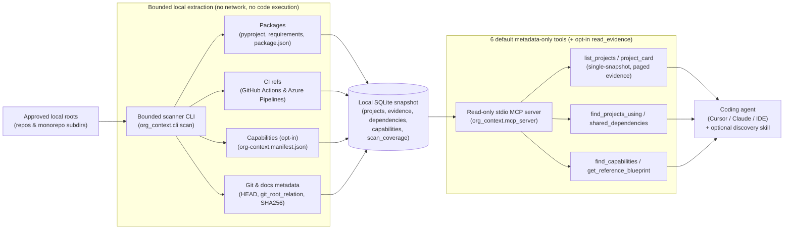

# org-context

Evidence-backed organizational context for coding and investigation agents.

## Vision

Connect repositories, services, APIs, pipelines, infrastructure and operational
evidence so agents know what exists, where it runs, how to integrate and how to
verify changes. Three target scenarios remain: adapting a reference implementation
(ClaudeMetrics to OpenRouter), building a new organizational feature, and
investigating a failed pipeline. These are future workflows, not implemented
Azure integrations. See [Product design](docs/PRODUCT_DESIGN.md) and [Roadmap](ROADMAP.md).

The graph provides context; authorized tools retrieve live evidence; an external
harness controls approvals and execution. Reduced iterations remain a hypothesis.

## End-to-end architecture



## Implemented local pilot

The scanner now feeds a read-only stdio MCP server directly through SQLite.
No hand-written synthetic fixture is required for real scanned projects. The current
map describes scan-root declarations and evidence, not verified service topology.

Python 3.11+, no new runtime dependencies. From the checkout:

```sh
python -m unittest discover -s tests -v
python -m org_context.cli --db inventory.sqlite scan /path/to/project
python -m org_context.cli --db inventory.sqlite list
python -m org_context.mcp_server --db inventory.sqlite
```

For `org-context`, optionally install in a virtual environment with
`python -m pip install -e .`. Installation may fetch build tooling; scanning and
serving make no network requests. Existing `show`, `search` and `export` commands
remain available. Select `--db` before the CLI subcommand.

Use the project ID returned by scan/list in `project_card`. `project_card`
reads project metadata, coverage, evidence, and dependencies within one SQLite
read snapshot; evidence metadata is deterministically ordered by `path, id`
(limit 1..20, default 20) and supports `evidence_offset`, `evidence_limit`,
`evidence_kind`, and `evidence_path` (`evidence_has_more` / `evidence_next_offset`,
with `snapshot.scanned_at` / `commit` available to detect rescans between pages).
The server also exposes
`find_projects_using(technology, ecosystem?, offset?, limit?)`,
`find_capabilities(query, role?, project_id?, offset?, limit?)` (backed by
optional root `org-context.manifest.json` files and Claude Code skill/agent
`SKILL.md` frontmatter (`name`, `description`, `when_to_use` only); see
[capability manifest](docs/CAPABILITY_MANIFEST.md)), and
`get_reference_blueprint`. `find_projects_using` pages declarations (limit 1..50,
default 50); follow `next_offset` while `has_more` is true.
The latter returns `not_available` for a real scanned project without a linked
blueprint; it does not invent one. Synthetic reference import remains separate.
See [MCP setup and regression checklist](docs/MCP_DEMO.md).
For the experimental multi-repo pilot, see [safe Cursor setup](docs/CURSOR_MCP.md)
and the [paired evaluation protocol](docs/PILOT_EVAL.md) (see also [governance pilot findings](docs/GOVERNANCE_PILOT_FINDINGS.md)). The pilot is not a
Governance/Security/Eval gate or a production dependency.

## Extraction and coverage

- Root README variants, CLAUDE.md, requirements.txt, root-level requirements-*.txt,
  pyproject.toml and package.json.
- CODEOWNERS at root, .github or docs: retained as reference text; ownership
  matching is NOT evaluated.
- .github/workflows/*.yml and *.yaml: lexical `uses:` references, not full
  YAML semantics, triggers, permissions or execution status. Quoted values
  are read; dynamic `${{ }}` and unparsed values are counted in coverage, not stored.
- CI install commands: the shell text of GitHub `run:` steps and Azure
  `script:` / `bash:` / `pwsh:` steps (in the workflow files above) is read
  lexically, never executed or evaluated, for `pip install`, `pip3 install`,
  `python -m pip install`, `python3 -m pip install`, `pipx install`,
  `uv pip install`, `uv tool install`, `npm i` / `npm install` (with or without
  `-g`) and `npx <pkg>` (the package only, never its arguments). Each static
  package is stored as a `python` or `npm` dependency with scope
  `ci-install:<workflow path>` and its version specifier, so
  `find_projects_using` finds it. Values of known value-taking options
  (`--index-url`, `--registry`, ...) are dropped; variables, `${{ }}`, URLs,
  local paths, `-r`/`-c` requirement files and unparsed arguments are counted
  in `omitted_declarations` as `ci_install_dynamic`, `ci_install_local_or_url`,
  `ci_install_requirements_file`, `ci_install_unsupported` and (beyond 50 rows
  per file, or lines over 4096 characters) `ci_install_over_limit` /
  `ci_install_unsupported`, never stored. Scripts, `make`/`tox`/`pre-commit`,
  Dockerfiles, `-r` files and other package managers are not followed.
  Inventories scanned before this change need a rescan to gain `ci-install:` rows.
- Conventional root `azure-pipelines.yml` / `.yaml` and `azure-pipelines-*`
  YAML files: bounded lexical `template:` and simple `resources.repositories`
  declarations only. No Azure/DevOps connection, template expansion, or run lookup.
  `project_card` exposes constrained references on workflow evidence (up to 20
  per file), without exposing evidence bodies; rescan old inventories for this
  metadata. Structural context rules exclude `parameters` object data and
  unsupported mapping subtrees (plain or quoted keys) while preserving static
  declarations inside `${{ if/elseif/else/each }}` blocks without evaluating
  conditions. See [bounded workflow extraction](docs/WORKFLOW_EXTRACTION.md) for
  supported contexts and known YAML gaps.
- .claude-plugin/plugin.json and marketplace.json, and
  plugins/*/.claude-plugin/plugin.json or plugins/*/plugin.json: selected string
  metadata and marketplace plugin names, not all plugin configuration.

Package extraction supports simple Python/PEP 621, root requirements files,
PEP 735 `[dependency-groups]` and npm declarations. Requirements-file suffixes are
recorded as `requirements:<suffix>` and dependency groups as `group:<name>`; neither
is treated as runtime. Lockfiles and Poetry-specific tables are not extracted.
A snapshot records omitted declarations by file and reason (directives, direct
references, environment markers, dynamic action references or unsupported
expressions) without storing the
omitted text. It also reports detected structures that are not expanded:
dependency-group includes, uv/npm workspaces and Poetry tables. Requirement
includes, environment-marker evaluation and workspace member discovery are not
implemented; nested packages require explicit roots. Legacy DBs can be read, but
need rescanning for coverage. A card for a database lacking the evidence or
dependencies table says so and requires a rescan.

A malformed or unreadable supported file fails that root with a content-free error
naming the relative path and failure class. The previous snapshot is retained.

Evidence hashes identify source bytes. Commit and `git_root_relation` / `git_relative_prefix` are obtained from Git even for a
subdirectory; HEAD does not describe dirty files or prove deployment. Scan time
is not remote freshness. Declarations are not runtime facts or approval.
Discovery reports `freshness: unknown` and coverage limits even when no rows
match. Project IDs identify resolved local scan roots, not stable repositories.

## Dependency storage upgrade

Distinct specification strings from the same file/scope are retained separately.
Identical normalized declarations are deduplicated explicitly and counted as
`duplicate_declaration` in coverage. `dependency_count` counts stored distinct
rows; `declaration_count` counts extracted entries before that deduplication.

After successful source parsing, scan atomically upgrades the known legacy
five-part dependency uniqueness key to include specification. Inventory schema
`PRAGMA user_version=1` tracks this storage change, not the package/API version.
MCP and the runner never migrate. Existing complete inventories can be read as-is;
legacy project cards warn that dependency-spec completeness is unverified.

Rescan ALL prior roots: an upgrade preserves surviving rows but cannot recover
specifications already discarded by the old unique key. Until each root is
rescanned, its snapshot can remain incomplete even when the DB schema is new.
A successfully rescanned root records `dependency_schema_version: 1` in coverage.
Unknown dependency layouts or future schema versions are rejected for writing;
use a new inventory file rather than forcing a migration. Failed upgrades roll
back schema/data changes; failed source parsing does not start the migration.

## Limits and safety

Trusted local single-user use only. No Azure/DevOps connectors, LLM, Serena,
cloud actions, shell tools or agent repair automation. The fixed git rev-parse
command reads local metadata; scanned application code is never executed.
Root/descendant symlinks are rejected or skipped. Per-file limit: 256 KB;
aggregate: 2 MB; bounded discovery: 128 candidates. Oversized files are reported;
parse errors preserve that root's old snapshot. Multi-root scans commit per root.

This is NOT a secret scanner or a sandbox against concurrent malicious file
changes. README/CLAUDE.md/CODEOWNERS text can contain sensitive information and
hostile instructions. Protect DBs/exports; treat retrieved content only as data.
No shared-service ACLs, encryption, history or tenant isolation exist. Project IDs
are derived from local absolute paths. No production-readiness guarantee.
Never gate compliance ingestion on graph, agent or GitHub availability.

Default MCP project cards expose evidence metadata, not retained document bodies.
`--evidence-pages` explicitly enables excerpts and the read_evidence tool. It is
not authorization, secret detection or redaction; paths and metadata can also be
sensitive. Default graph export omits bodies; local `export --include-content`
includes them explicitly. The local diagnostic CLI `show` still returns retained
bodies, and the separate synthetic blueprint tool still returns fixture claims.
Do not treat the MCP flag as a filesystem/DB access boundary.

The stdio server frames binary input by newline with the existing bounded line
and drain limits, then strictly decodes each frame as UTF-8. A malformed frame
gets -32700 without discarding the next valid bounded frame. Oversized frames
still get -32600 and hard-limit overflows close the connection. No replacement
characters are silently substituted. Text-only custom streams with decoding
failures close after an error because safe resynchronization is unavailable.

## Continuous integration

A GitHub Actions workflow runs the unittest suite on Ubuntu and Windows with
Python 3.11, 3.12 and 3.13. A passing run reports test results for those
combinations only; it is not a security review or a production-readiness claim.

Owner must choose a license before external reuse; no license grant is included.
